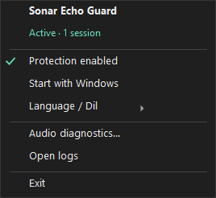
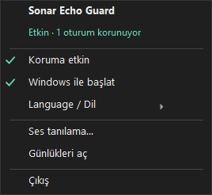

# Sonar Echo Guard

[](https://github.com/ayrzDev/SonarEchoGuard/actions/workflows/build.yml)
[](LICENSE)

A compact Windows tray utility for the Discord + SteelSeries Sonar screen-share echo workaround.

I wanted the fix to stay out of the way: a small right-click menu, two checkboxes, and nothing to babysit while sharing my screen.

| English | Türkçe |
| --- | --- |
|  |  |

## Download

Get **SonarEchoGuard-windows-x64.zip** from the [latest release](https://github.com/ayrzDev/SonarEchoGuard/releases/latest). Extract it, then run `SonarEchoGuard.exe` for portable use or `Install.ps1` for installation and startup at sign-in.

Requires Windows 10/11 x64 and .NET Framework 4.8 or newer. No SDK or Python installation is needed.

## What it does

On affected Sonar setups, muting Discord in `sndvol` on the **SteelSeries Sonar - Microphone playback endpoint** stops duplicate voice in screen shares. This app reapplies that specific mute when sessions reset or new ones appear.

- Targets only Discord playback on Sonar Microphone.
- Preserves the actual microphone recording input.
- Leaves Sonar Chat, Gaming, Media, Aux, physical outputs and other apps unchanged.
- Restores only this instance's changes on pause or normal exit.
- Preserves pre-existing user mutes.

The Windows audio integration is implemented directly through the documented COM ABI. No Discord patching, driver replacement, injection, recording or network service is used.

## Menu

Right-click the shield in the notification area. Left-click or relaunching the app also opens the same small menu.

| English | Türkçe | Action |
| --- | --- | --- |
| Protection enabled | Koruma etkin | Pause/resume protection. |
| Start with Windows | Windows ile başlat | Toggle quiet startup at sign-in. |
| Language / Dil | Language / Dil | Select English or Türkçe. The choice is saved. |
| Audio diagnostics | Ses tanılama | Inspect playback devices and Discord sessions. |
| Open logs | Günlükleri aç | Open the local logs folder. |
| Exit | Çıkış | Restore this instance's changes and exit. |

The initial language follows Windows. English and Turkish can be selected at any time. Preferences and local reports live under `%LOCALAPPDATA%\SonarEchoGuard`; diagnostic reports are not uploaded.

The installer uses `%LOCALAPPDATA%\Programs\SonarEchoGuard`, adds a Start menu shortcut and a per-user startup entry. To uninstall, run `Uninstall.ps1` from the extracted release. It closes the app cleanly and removes the startup entry. Logs and preferences are kept.

## Build and test

```powershell
.\Build.ps1
.\Test.ps1
```

The build uses the .NET Framework compiler included with Windows. Integration tests require real Sonar playback endpoints and initialize silent WASAPI sessions without starting playback or capturing a microphone.

For read-only diagnostics:

```powershell
.\SonarEchoGuard.exe --diagnose "$env:TEMP\SonarEchoGuard-diagnostics.json"
```

The GitHub workflow builds and packages the executable. Hardware integration tests run locally because hosted runners do not have Sonar devices.

## Scope

This automates the mixer workaround. It checks once per second, so a newly opened session may exist briefly before it is handled. Session restoration requires a normal exit. Test a screen share with another listener to confirm the audible result on your setup.

## Windows API references

- [MMDevice enumeration](https://learn.microsoft.com/en-us/windows/win32/api/mmdeviceapi/nn-mmdeviceapi-immdeviceenumerator)
- [Audio-session information](https://learn.microsoft.com/en-us/windows/win32/api/audiopolicy/nn-audiopolicy-iaudiosessioncontrol2)
- [Per-session volume control](https://learn.microsoft.com/en-us/windows/win32/api/audioclient/nn-audioclient-isimpleaudiovolume)

## License

MIT. Copyright © 2026 Ayrz. See [LICENSE](LICENSE).
